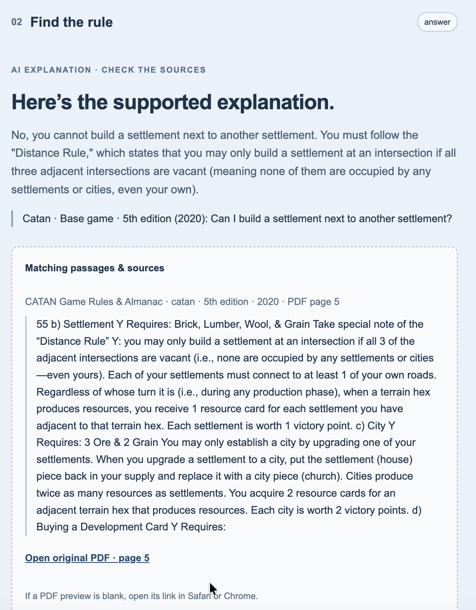
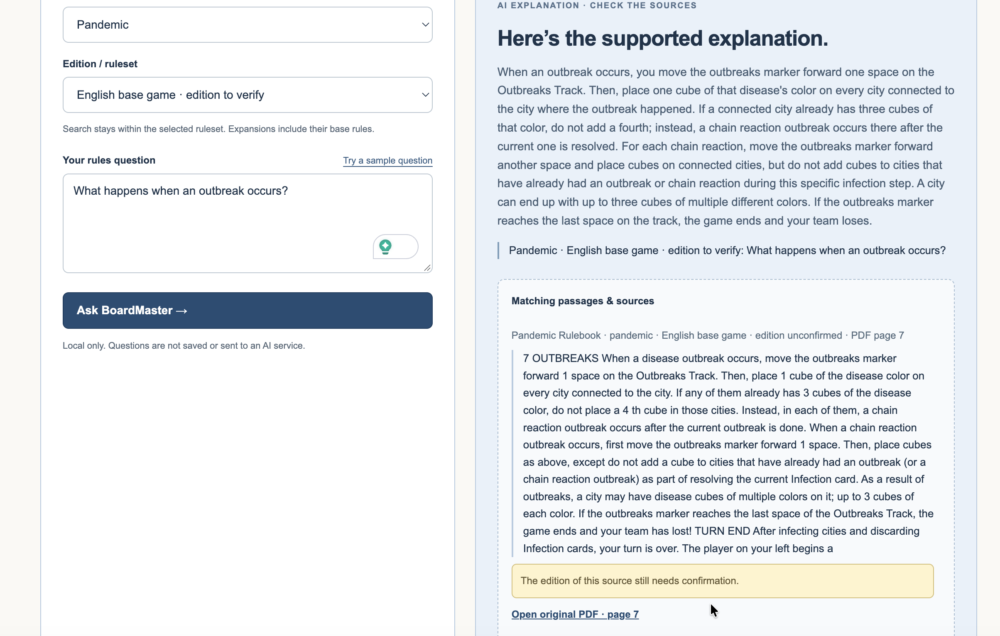

# Course API progress — 21 October 2026

## Implementation

Added Alibaba Cloud Bailian Token Plan Team Edition via the course-provided
OpenAI-compatible endpoint. `scripts/start-course.zsh` selects the course adapter;
its default model is qwen3.8-flash. Credentials remain server-side and are entered
at a hidden prompt; they are not saved. A local semaphore permits one in-flight
course request per server process; requests are not automatically retried.

Final local verification: **28 tests passed, none skipped** on 21 October 2026.
Automated tests cover the course adapter, citation validation, API errors,
local concurrency control, retrieval and HTTP serving. They mock model requests
and do not measure real model accuracy or consume course credits.

## User-observed live browser cases

The following test results and screenshots were supplied by the team member after the course
startup instructions. The included screenshots do not display provider/model metadata, so they
establish browser behaviour; provider provenance depends on the server startup
configuration. Successful manual opening of the PDF links was not reported.

| Case | Expected | Observed | Result |
| --- | --- | --- | --- |
| Catan base: Can I build a settlement next to another settlement? | No; distance rule, supported by base rules | Explains adjacent intersections must be vacant; PDF page 5 citation | Pass for this case |
| Catan base: Should I build a city or a settlement to win? | Refuse strategy advice without inventing a ruling | Explicit refusal of strategy advice; no citations | Pass for this case |
| Pandemic base: What happens when an outbreak occurs? | Explain marker movement, neighbouring cubes and chain reactions with supporting source | Describes these rules and losing at the final track space; PDF page 7 citation | Core explanation supported; chain-reaction wording caveat below |

The strategy-refusal result is recorded from the member’s observed browser test;
its original screen capture is not included in this handoff.

## Limits and next checks

Pandemic's answer says not to add cubes to previously outbroken cities in the
“specific infection step”; the displayed source more precisely says while
resolving the current Infection card. This wording needs correction/retest with
a question that distinguishes separate Infection cards in the same step. Do not
claim this screenshot proves every part of the response is precise.

The Pandemic edition remains unconfirmed. Chess remains search-only until laws
and commentary are separated. Missing-evidence, ambiguity, disputed-event and
cross-game live cases remain outstanding, as does the fixed 32-case evaluation.
These three examples do not establish aggregate accuracy. Confirm source-use
permissions and course key expiry (first batch: 19 November, per course notice).

The screenshots reveal stale UI privacy text claiming questions are never sent
to an AI service. That text was corrected after these captures; refresh the
browser to see the current disclosure.
